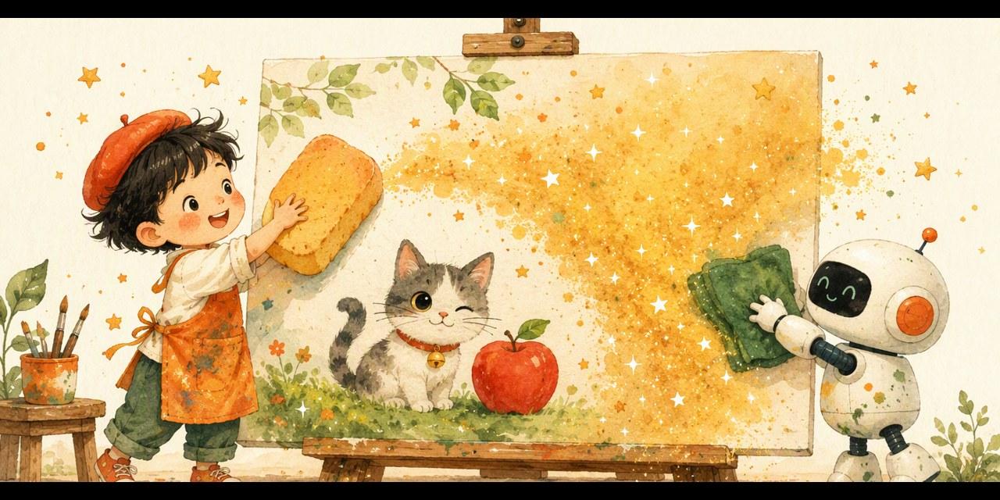

# 擦雾小画家 · 越擦越清楚（Clear The Fog）

> 雾里看花，越擦越清楚——把 DDPM 的「撒沙子、擦沙子」变成孩子的猜画游戏。

## 这是什么？

「和孩子一起学AI」社群 **AI十哲系列 · 第十课（收官课）** 的配套游戏，把 2020 年的经典模型 **DDPM（扩散模型）** 变成孩子能上手玩的猜画挑战：

- 🌫️ **雾里看花**：画蒙着一层厚厚的雾，你敢不敢不擦就猜？
- 🧽 **擦一擦**：每擦一次，雾薄一点、线索多一点——但星星也会变少！
- ⭐ **越早越勇**：浓雾里猜对 3 颗星，擦到最后只剩 1 颗——赌不赌？

## 怎么玩？

1. 双击打开 `index.html`（手机、电脑都行，无需联网）
2. 看雾里是什么，从三个候选里选出答案；拿不准就「擦一擦」
3. 三大关卡层层升级：

- 🌫️ **雾里看花**：太阳、苹果、小鱼——轮廓分明好上手
- 🖌️ **一擦一猜**：小猫还是兔子？花朵还是棒棒糖？轮廓会骗人，细节说实话
- 👑 **火眼金睛**：星星还是雪花？大树还是西兰花？敢赌吗？

4. 集齐三枚徽章 🌫️🖌️👑，领取「**DDPM 降噪小画家证书**」，截图发群里领奖状！

## 教育目标

- 理解 DDPM 的核心直觉：**先给照片一点点撒沙子（加噪），再教 AI 一点点擦回去（去噪）**——倒着走，就学会了画画
- 体会「一次一小步，一百步出奇迹」：大目标拆小步，背书、改错题、练钢琴都一样
- 媒介素养：AI 画得太真，眼睛也会被骗——多问一句「这是谁拍的？真的吗？」
- 收官回顾：从 1957 年的感知机到 2020 年的 DDPM，十课全家福，下一段故事轮到孩子来写

## AI十哲系列游戏

| 课次 | 论文 | 游戏 | 仓库 |
| --- | --- | --- | --- |
| 第一课 | 感知机（1957） | 人类还是AI | [human-or-ai](https://github.com/pulj26pulj26/human-or-ai) |
| 第二课 | 图像识别 | 苹果还是不是苹果 | [apple-or-not](https://github.com/pulj26pulj26/apple-or-not) |
| 第三课 | LSTM（1997） | 记忆特工队·小本本大冒险 | [memory-agent](https://github.com/pulj26pulj26/memory-agent) |
| 第四课 | ResNet（2015） | 高速公路工程师·帮AI盖大楼 | [ai-highway](https://github.com/pulj26pulj26/ai-highway) |
| 第五课 | GAN（2014） | 真假画廊·小评委大挑战 | [spot-the-fake](https://github.com/pulj26pulj26/spot-the-fake) |
| 第六课 | AlphaGo（2016） | 胜率指挥官·帮AlphaGo想下一步 | [go-commander](https://github.com/pulj26pulj26/go-commander) |
| 第七课 | 注意力机制（2017） | 焦点小侦探·带着问题找重点 | [spotlight-quest](https://github.com/pulj26pulj26/spotlight-quest) |
| 第八课 | BERT（2018） | 完形小侦探·前后都看看 | [fill-in-detective](https://github.com/pulj26pulj26/fill-in-detective) |
| 第九课 | GPT-3（2020） | 接龙小作家·越读越会写 | [next-word-wizard](https://github.com/pulj26pulj26/next-word-wizard) |
| 第十课 | DDPM（2020） | 擦雾小画家·越擦越清楚 | **clear-the-fog（本仓库）** |

## 本地运行

无需安装任何东西，双击 `index.html` 即可运行。也可以访问在线版：

**https://pulj26pulj26.github.io/clear-the-fog/**

---

Made with ❤️ by 和孩子一起学AI
